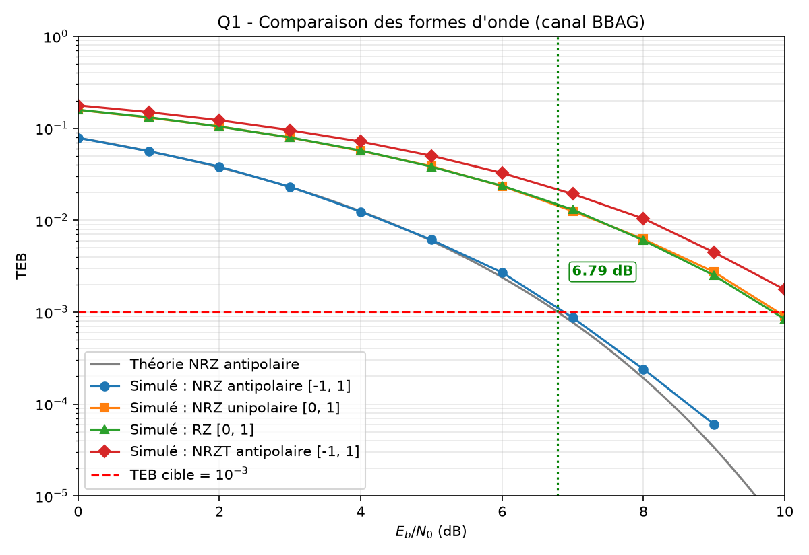
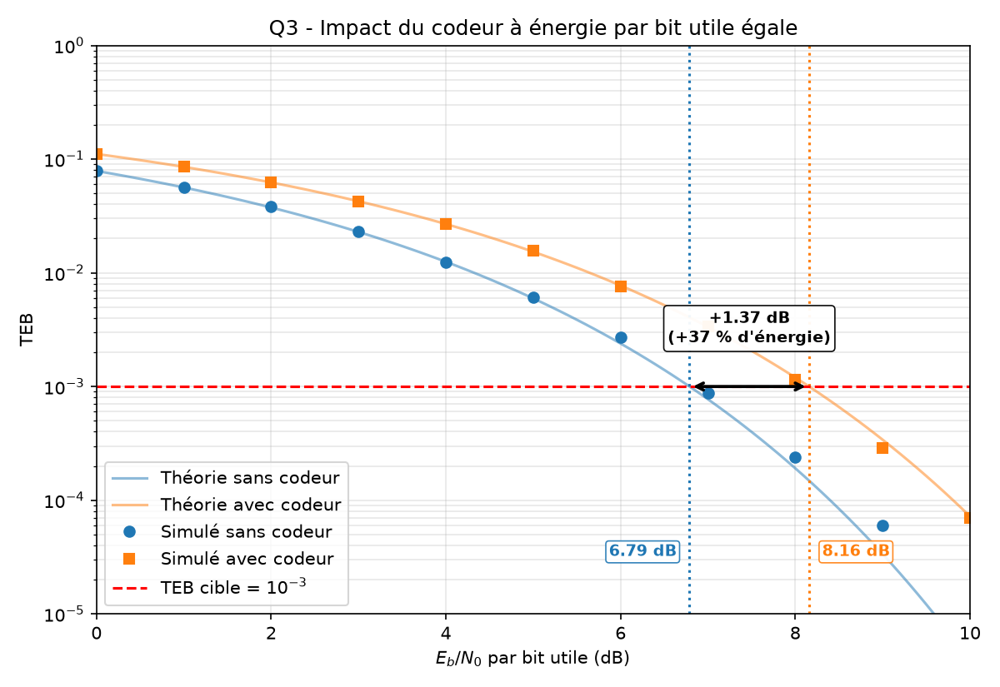
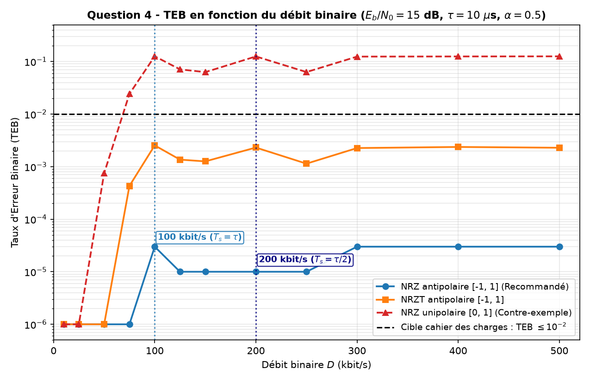
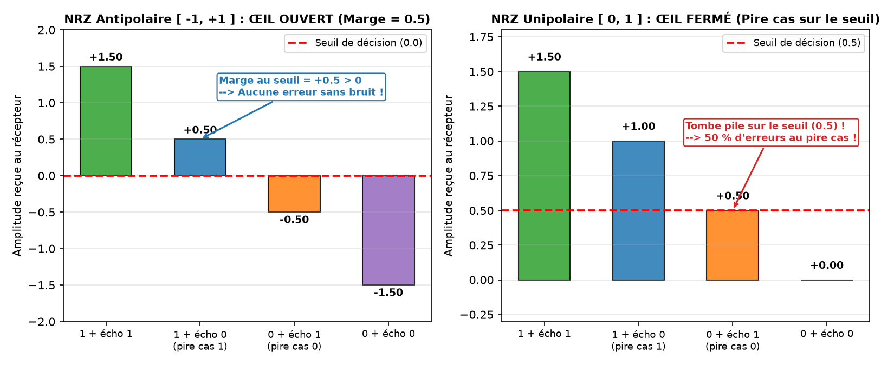

# SIT213 — Simulateur de Chaîne de Transmission Numérique & Web DSP Studio

[](https://openjdk.org/)
[](./tests)
[](./mesures)
[](./web)

**Auteurs :** Nathan Weymeels, Antonin Pons, Amandine Touchais, Aymeric Schaeffer  
**Établissement :** IMT Atlantique — Formation d'Ingénieur en Partenariat (FIP 2A · UV SIT210 / Module SIT213)

---

## Présentation

Ce dépôt contient l'intégralité du simulateur de transmission numérique point-à-point développé en **Java 17** (étapes TP1 à TP6), les campagnes de simulation et d'optimisation mathématique en **Python** (`mesures/`), ainsi qu'un **Laboratoire Web Interactif (`web/`)** développé en **React 19 + TypeScript + Vite + Tailwind CSS** permettant de piloter et visualiser la chaîne de transmission en temps réel dans le navigateur.

```text
Source ──► Codeur (1/3) ──► Émetteur (NRZ/RZ/NRZT) ──► Canal (BBAG + Multitrajets) ──► Récepteur ──► Décodeur ──► Destination
  │             │                     │                            │                       │             │
  ▼             ▼                     ▼                            ▼                       ▼             ▼
Sonde         Sonde                 Sonde                        Sonde                   Sonde         Calcul
Logique       Logique            Analogique                   Analogique                Logique        du TEB
```

---

## Architecture du Projet

| Dossier | Description |
| :--- | :--- |
| [`src/`](./src) | Code source Java 17 modulaire : `sources`, `transmetteurs`, `codesbinaires`, `destinations`, `visualisations`, `information`, `simulateur`. |
| [`tests/`](./tests) | Suite de **303 tests unitaires et d'intégration JUnit 6** avec couverture de code **JaCoCo (> 93 %)**. |
| [`script/`](./script) | Scripts POSIX d'automatisation hors IDE : `compile`, `simulateur`, `runTests`, `genDoc`, `cleanAll`, `genDeliverable`. |
| [`mesures/`](./mesures) | Scripts Python de campagnes Monte-Carlo (`teb.py`, `pbruit.py`, `teb_multitrajet.py`, `teb_multitrajets.py`) et études complètes des cas clients TP6 ([`environnement1/`](./mesures/environnement1), [`environnement2/`](./mesures/environnement2)). |
| [`web/`](./web) | **SIT213 Digital Transmission Studio** : interface web temps réel (Oscilloscope multi-sondes, Diagramme de l'œil, Histogramme Box-Muller & Q-Q Plot, Courbes TEB, Cartes de chaleur 2D Multitrajets, Simulateurs TP6 Environnements 1 & 2). |

---

## 1. Simulateur Java (Ligne de Commande Unique)

### Compilation et Exécution

```bash
# 1. Compiler les sources Java dans bin/
./script/compile

# 2. Lancer le simulateur avec les options souhaitées
./script/simulateur [options]

# 3. Exécuter la suite de tests JUnit 6 + rapport de couverture JaCoCo
./script/runTests
```

### Options de l'Interface Commune

| Option | Description | Valeur par défaut |
| :--- | :--- | :--- |
| `-mess m` | Séquence binaire fixe ($\ge 7$ chiffres `0`/`1`) ou longueur aléatoire ($1$ à $6$ chiffres décimaux). | `100` bits aléatoires |
| `-seed v` | Graine entière des générateurs pseudo-aléatoires (message et bruit gaussien). | Sans graine fixe |
| `-s` | Active l'affichage graphique des sondes logiques et analogiques Swing. | Désactivé |
| `-form f` | Choix du code en ligne analogique : `NRZ`, `NRZT` ou `RZ`. | `RZ` |
| `-nbEch N` | Nombre d'échantillons par bit de canal ($N \ge 1$ en NRZ, $N \ge 3$ en RZ/NRZT). | `30` échantillons/bit |
| `-ampl min max` | Amplitudes associées aux niveaux bas et haut ($A_{\min} = 0$ imposé en `RZ`). | `0.0` et `1.0` |
| `-snrpb s` | Rapport signal à bruit par bit $E_b/N_0$ en décibels (active le canal BBAG). | Canal non bruité |
| `-ti dt ar ...` | Jusqu'à **5 trajets indirects** définis par leur retard `dt` (échantillons) et amplitude relative `ar` $\in [0, 1]$. | Aucun trajet indirect |
| `-codeur` | Active le codeur/décodeur de canal à triplets ($0 \mapsto 010$, $1 \mapsto 101$, distance de Hamming 3). | Désactivé |
| `-save fichier` | Exporte les échantillons analogiques reçus dans un fichier texte. | Désactivé |

---

## 2. Études de Cas Client (TP6 — Appel d'Offres)

### Environnement 1 : Capteurs sur Batterie (Canal BBAG, $\text{TEB} \le 10^{-3}$)
- **Paramètres** : $N_0 = -80\text{ dBm/Hz} = 10^{-11}\text{ J}$, atténuation de ligne $40\text{ dB}$ ($\times 10^4$), batterie de $3\text{ J}$, trafic maximal $10^6\text{ bits utiles/jour}$.
- **Solution optimale retenue** : **NRZ antipolaire $[-1, +1]$ sans codeur** :
  $$\text{TEB} = Q\left(\sqrt{\frac{2E_b}{N_0}}\right) = 10^{-3} \implies \frac{E_b}{N_0} \approx 4{,}7748 \iff \mathbf{6{,}79\text{ dB}}$$
  - Énergie émise par bit utile : **$0{,}4775\ \mu\text{J/bit}$** ($0{,}5012\ \mu\text{J/bit}$ avec marge opérationnelle à $7{,}00\text{ dB}$).
  - Autonomie de la batterie : **$6{,}28\text{ jours}$** ($5{,}99\text{ jours}$ à $7{,}00\text{ dB}$).
- **Impact du codeur correcteur TP5 ($R_c = 1/3$)** :
  - $3p^2 - 2p^3 = 10^{-3} \implies p \approx 1{,}84\,\% \implies E_c/N_0 \approx 3{,}39\text{ dB}$ par bit canal, soit **$E_b/N_0 \approx 8{,}16\text{ dB}$ par bit utile** ($+1{,}37\text{ dB}$).
  - Surconsommation énergétique nette de **$+37{,}05\,\%$** ($0{,}6544\ \mu\text{J/bit utile}$), réduisant l'autonomie à **$4{,}58\text{ jours}$** (**$-27{,}03\,\%$**).




### Environnement 2 : Émetteur Haut Débit (Canal à 2 Trajets : $\tau = 10\ \mu\text{s}$, $\alpha_1 = 0{,}5$)
- **Conversion physique** : $dt = \tau \times D \times N_e = 0{,}3 \times D_{\text{kbit/s}}$ (pour $N_e = 30$).
- **Supériorité du NRZ antipolaire $[-1, +1]$** :
  - L'amplitude directe ($1{,}0$) dépassant strictement celle de l'écho ($0{,}5$), **le diagramme de l'œil reste ouvert en permanence** (marge minimale $1{,}0 - 0{,}5 = +0{,}5 > 0$ par rapport au seuil $0$), contrairement à l'unipolaire $[0, 1]$ dont l'œil se ferme sur le seuil $0{,}5$ dès $D \ge 69\text{ kbit/s}$.
  - À $D = 100\text{ kbit/s}$ ($T_s = \tau$) comme à $D \ge 200\text{ kbit/s}$, le NRZ antipolaire garantit $\text{TEB} \approx 1\text{--}3 \times 10^{-5} \ll 10^{-2}$ à $15\text{ dB}$, et respecte la cible $\text{TEB} \le 10^{-2}$ dès **$E_b/N_0 \ge 9{,}4\text{ dB}$** ($5{,}6\text{ dB}$ de marge).




---

## 3. Laboratoire Web Interactif (`web/`)

L'application web située dans [`web/`](./web) embarque un moteur DSP TypeScript reproduisant bit-à-bit le comportement du simulateur Java :
1. **Oscilloscope & Sondes Synchronisées** : visualisation temps réel des bits sources, des triplets du codeur, du signal émis $s(t)$, du signal bruité avec multitrajets $r(t)$, des fenêtres d'intégration, du Diagramme de l'Œil et génération instantanée de la commande CLI Java.
2. **Études Client TP6 Interactives** : calculateurs dynamiques et démonstrateurs pour les Environnements 1 et 2.
3. **Courbes TEB & Codage (TP3/TP5)** : comparateur théorique et simulateur Monte-Carlo en direct ($E_b/N_0$ utile vs $E_c/N_0$ canal).
4. **Cartographie Multitrajets 2D (TP4)** : carte de chaleur interactive $\text{TEB}(dt, \alpha)$ de 1 à 5 échos.
5. **Analyseur Statistique Box-Muller (TP3)** : histogramme de densité gaussienne et diagramme Q-Q (Droite de Henry).

### Lancer le Frontend en local

```bash
cd web
npm install
npm run dev
```
